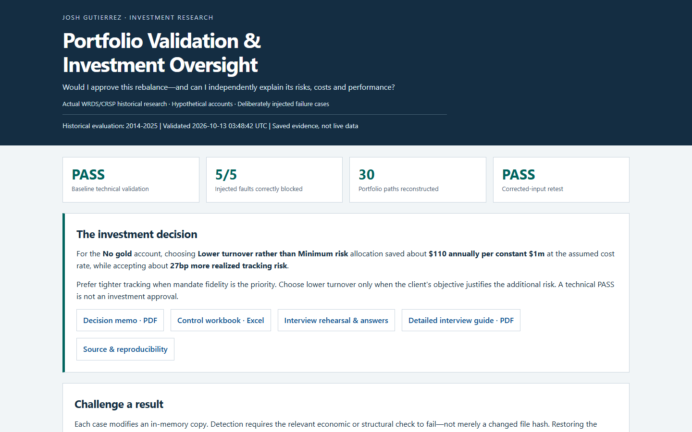
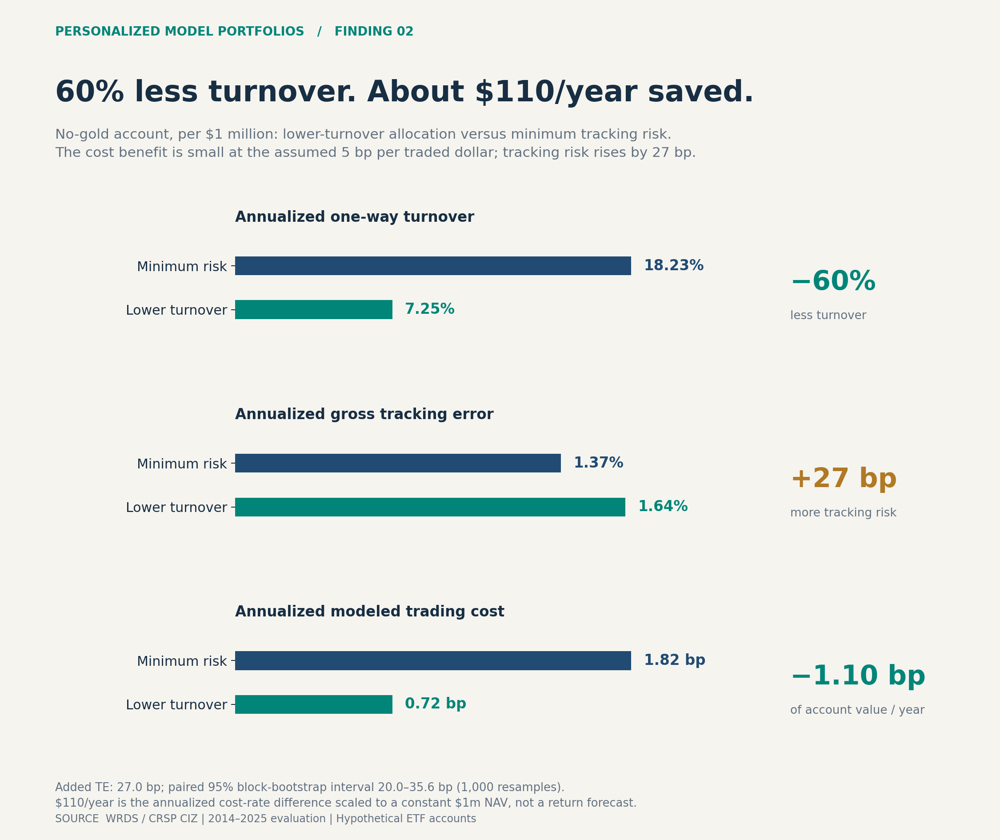
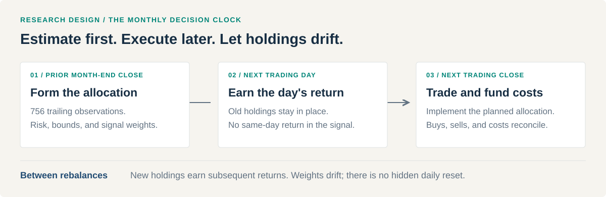
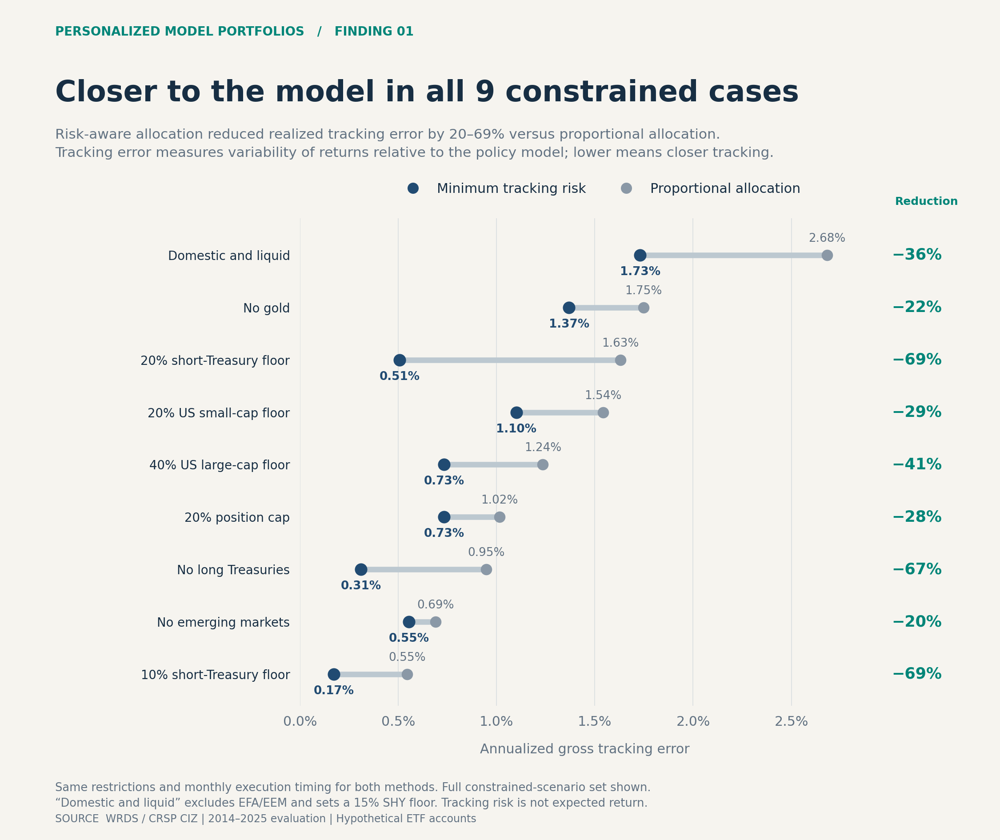
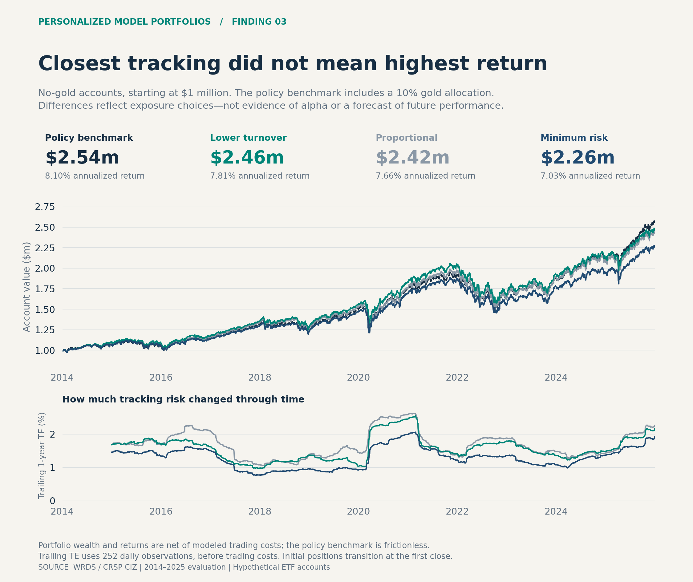
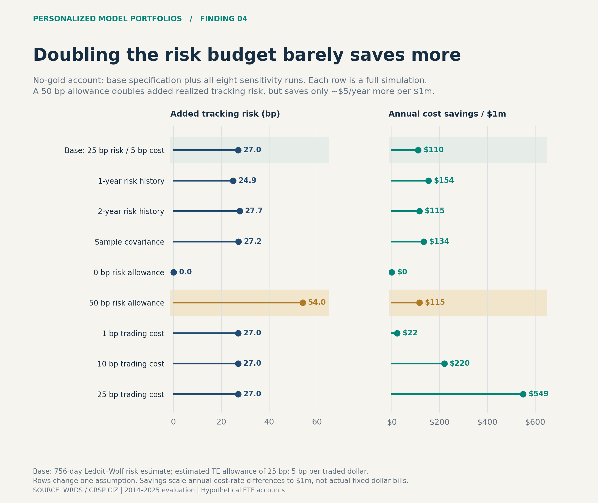

# Personalized Model Portfolios

**Portfolio construction, independent Python + SQL validation, and investment oversight.**

How much tracking risk is a client restriction worth—and can a second implementation verify the resulting portfolio? This project combines a **2014–2025 WRDS/CRSP-backed ETF study** with a separately implemented challenger that reconstructs holdings, fees, NAV, benchmark returns, and cumulative return contributions.

[**Explore the evidence dashboard**](https://joshgutierrez56.github.io/personalized-model-portfolios/) · [Decision memo · PDF](outputs/oversight/Portfolio_Oversight_Memo.pdf) · [Control workbook · Excel](outputs/oversight/Portfolio_Oversight.xlsx) · [Browse the validator](oversight_core.py)

[](https://joshgutierrez56.github.io/personalized-model-portfolios/)

## What the saved evidence shows

| Result | Scope and receipt |
| :--- | :--- |
| **30 paths / 90,540 daily records reconstructed** | 10 hypothetical accounts × 3 methods; [baseline validation](outputs/oversight/validation_summary.json) |
| **115 baseline controls passed** | Accounting, provenance, chronology, risk windows, constraints, and versioned SQL; [control methodology](docs/OVERSIGHT_METHODOLOGY.md) |
| **5 / 5 deliberately injected faults blocked** | Wrong return definition, duplicate trade, look-ahead timestamp, prohibited allocation, and fee error; [incident evidence](outputs/oversight/incident_summary.json) |
| **Clean retest passed; original inputs unchanged** | Mutations use in-memory copies; [run fingerprints](outputs/oversight/run_receipt.json) |
| **Lower tracking error in all 9 constrained cases** | Minimum-risk versus proportional allocation: **20–69%** reduction, **35.5%** median; [research results](docs/RESULTS.md) |

These are saved research results, not live operating statistics. A technical PASS releases evidence for review; it does not approve a trade. For current automated checks, inspect the [commit-specific Linux and Windows CI results](https://github.com/JoshGutierrez56/personalized-model-portfolios/actions/workflows/validation.yml).

## The investment decision

**A dramatic turnover reduction need not be a compelling economic benefit.** In the no-gold account, lower-turnover allocation reduced annual one-way turnover from **18.23% to 7.25%**, but increased realized tracking error from **1.37% to 1.64%**. At the assumed cost of 5 bp per dollar bought or sold, the saving was only **1.10 bp annually—about $110 per constant $1m NAV**.

[](outputs/wrds/visual_brief/WRDS_results_visual_brief.pdf)

The dollar figure scales an annual cost-rate difference; it is not an exact CAGR benefit or guaranteed saving. The added-risk estimate has a paired 95% block-bootstrap interval of **20.0–35.6 bp**, conditional on this historical sample. Minimizing tracking error is not maximizing return, and the observed return ranking is not evidence of alpha.

[Executed notebook](01_cost_of_customization.ipynb) · [Full results](docs/RESULTS.md) · [Four-page visual brief](outputs/wrds/visual_brief/WRDS_results_visual_brief.pdf) · [Scenario CSV](outputs/wrds/scenario_summary.csv)

## Try the validator—no data subscription required

Use **Python 3.11** for the hash-locked, CI-verified environment. Clone the repository and create a virtual environment:

```bash
git clone https://github.com/JoshGutierrez56/personalized-model-portfolios.git
cd personalized-model-portfolios
python -m venv .venv
```

Activate it with `.venv\Scripts\Activate.ps1` in Windows PowerShell, or `source .venv/bin/activate` on macOS/Linux. Then:

```bash
python -m pip install --require-hashes -r requirements-demo-lock.txt
python run_public_demo.py --no-write
```

The walkthrough uses **explicitly artificial, hand-derived inputs**: reconcile the accounting, observe named faults being blocked, and inspect a corrected retest. It does not reproduce the market study or overwrite its published evidence.

To run the full public test suite, install the broader environment:

```bash
python -m pip install --require-hashes -r requirements-lock.txt
python -m pytest -q -W error
```

These tests need no WRDS login. [Reproduction routes and expected inputs](docs/OVERSIGHT_REPRODUCING.md) distinguish this public verification from an empirical rerun with your own licensed source data and original research ledgers. Missing market data stop the research pipeline; there is no synthetic-performance or alternative-vendor fallback.

Dependency inputs remain in `requirements.txt` and `requirements-demo.txt`. The two lock files also pin transitive dependencies and artifact hashes. Refresh deliberately using `uv pip compile <input> --python-version 3.11 --universal --generate-hashes --output-file <lock>` and repeat the checks. Locking the public environment does not supply licensed source observations.

## How it is built

| Layer | Inspectable implementation |
| :--- | :--- |
| Source and decision clock | [WRDS ingestion](wrds_data.py), [walk-forward simulation](walkforward.py), [data contract](docs/DATA.md) |
| Portfolio construction | [Allocation engine](portfolio_engine.py): bounded proportional, minimum tracking risk, and lower turnover within a risk budget |
| Independent challenge | [Validator](oversight_core.py), [separately declared policy](oversight_contract.json), [daily SQL](sql/oversight_daily_controls.sql), [trade SQL](sql/oversight_trade_controls.sql) |
| Fault investigation | [Oversight runner](run_oversight.py), [hand-derived and adversarial tests](tests/), [public walkthrough](run_public_demo.py) |
| Evidence delivery | [Release consistency guard](release_evidence.py), [dashboard builder](build_oversight_dashboard.py), [report builder](build_oversight_reports.py) |

The study uses **8 ETFs, 32,192 source security-day observations, and 4,320 allocation decisions**. Risk estimates are lagged; old holdings earn the execution day's return before the planned trade occurs at the close. Subsequent holdings drift, and transaction costs are funded by the account.



The challenger does not call the original engine's accounting or validation functions. It does share source data, economic assumptions, and the Ledoit–Wolf covariance dependency; it does **not** independently certify optimizer optimality. The public release guard checks artifact hashes and financial consistency, not external authenticity of the data.

**Stack:** Python, pandas, NumPy, DuckDB/SQL, scikit-learn, CVXPY/CLARABEL, Matplotlib, and PostgreSQL/libpq.

## Research exhibits

<details>
<summary>Tracking risk, wealth paths, and sensitivity analysis</summary>

### Risk-aware allocation



### Closest tracking did not mean highest return

The no-gold implementations ended at **$2.26m–$2.46m** from $1m, versus **$2.54m** for the frictionless benchmark retaining its gold allocation. Exposure differences dominate small trading-cost savings.



### Diminishing cost savings

Doubling the no-gold risk allowance from 25 to 50 bp approximately doubled the added realized tracking risk, while increasing modeled annual savings from **$110 to $115 per $1m**. Each sensitivity is a complete simulation.



[Sensitivity CSV](outputs/wrds/sensitivity_summary.csv) · [Chart calculations and provenance](outputs/wrds/visual_brief/README.md)

</details>

## Scope and limitations

- **Research prototype, not a live portfolio platform.** No tax lots, external client cash flows, calibrated market impact, executable share accounting, or production order management. Cumulative contributions are an initial-capital-scaled dollar-P&L decomposition, not Brinson or factor attribution.
- **Observed returns; assumed implementation.** Account restrictions, policy weights, initial wealth, and transaction costs are experimental assumptions. The benchmark is frictionless. SHY is a Treasury ETF, not cash; interim bound drift is monitored, not silently corrected.
- **Retrospective evidence.** Current-vintage CRSP and a fixed ETF universe retain revision and retrospective selection limitations. Lagged decisions address return look-ahead, not all point-in-time data issues or future performance.
- **Bounded independence.** Faults are deliberately injected, not client incidents. The wrong-return replay holds recorded trades fixed: it is a diagnostic comparison, not an investable alternative.
- **Public aggregates, private licensed rows.** Source security-day records and detailed holdings/trade ledgers are excluded. Built with AI coding and drafting assistance; code, checks, assumptions, and interpretation remain inspectable.

## Further reading

[Research methodology](docs/METHODOLOGY.md) · [Oversight methodology](docs/OVERSIGHT_METHODOLOGY.md) · [Licensed research setup](docs/REPRODUCING.md) · [Data-quality receipt](outputs/wrds/data_quality.json) · [Accounting audit](outputs/wrds/AUDIT.json)

[Interview field guide · PDF](outputs/oversight/Interview_Guide.pdf) · [Editable guide · DOCX](outputs/oversight/Interview_Guide.docx) · [60-minute practice and answer key](docs/INTERVIEW_PRACTICE.md) · [Practice PDF](outputs/oversight/Interview_Practice.pdf) · [Practice DOCX](outputs/oversight/Interview_Practice.docx) · [Superseded prototype archive](archive/README.md)

**Josh Gutierrez** · [GitHub](https://github.com/JoshGutierrez56)
