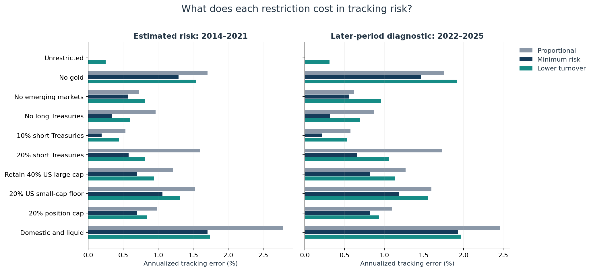

# Personalized Model Portfolios

**How much customization can a portfolio absorb before its exposures change materially?**

A small Jupyter research project on an ordinary portfolio-management problem: the
model allocation is available, but each account has different restrictions and
starting holdings.

The notebook compares bounded proportional allocation, minimum-tracking-risk
optimization, and a lower-turnover allocation with an explicit tracking-risk budget.
It uses eight ETFs and ten hypothetical client scenarios. No client or employer
data are used.

## Start here

Open [the notebook](01_cost_of_customization.ipynb) to read the executed study.
The first version estimates risk using **2014–2021** prices, then checks the frozen
allocations against **2022–2025** returns. This is a portfolio-construction study and
later-period exposure diagnostic, not a net-return strategy backtest.



## Run in Jupyter

Python 3.11 or 3.12 is recommended.

```bash
git clone https://github.com/JoshGutierrez56/personalized-model-portfolios.git
cd personalized-model-portfolios
python -m venv .venv
```

Activate with `.venv\Scripts\activate` on Windows or `source .venv/bin/activate`
on macOS/Linux, then:

```bash
python -m pip install -r requirements.txt
python -m ipykernel install --user --name personalized-portfolios --display-name "Personalized Portfolios"
python -m jupyterlab
```

Open `01_cost_of_customization.ipynb`, select the **Personalized Portfolios** kernel,
then **Restart Kernel and Run All Cells**. The first market-data run needs internet;
later runs reuse a local, hash-checked cache. No API key is required. Set `DATA_MODE`
to `"synthetic"` for an explicitly labeled offline example. A failed market download
never silently becomes simulated data.

## What to look for

- The risk cost of fund exclusions, position caps, and retained-holding floors.
- How estimated tracking risk compares with a later-period risk diagnostic.
- How much trading a 25-basis-point tracking-risk allowance can avoid.
- A sample, pre-cost trade list for a hypothetical account.
- Clear rejection of impossible constraints.

Lower in-sample tracking risk is expected by construction. The useful question is
whether the exposure trade-off remains sensible outside the estimation period.
Results, charts, and data provenance are generated by the notebook, not hard-coded.

## Initial result

In the saved historical run, minimum-risk allocations had lower later-period
tracking risk than proportional allocation in all nine constrained examples.
Allowing an extra 25 basis points of estimated tracking error reduced one-way
turnover by a median **6.33 percentage points** versus the minimum-risk portfolios.

The trade-off is not free. For the no-gold account, the lower-turnover allocation
needed 16.42% one-way turnover versus 26.01% for minimum risk, but its later-period
tracking error was 1.91% versus 1.47%. This is the decision worth discussing:
how much exposure difference is acceptable to avoid a trade?

Those figures describe ten hypothetical accounts, one historical split, and a
fixed exposure diagnostic. They are not evidence of higher investment returns.

## Files

- `01_cost_of_customization.ipynb`: research question, assumptions, calculations, charts, interpretation.
- `portfolio_engine.py`: allocation rules, covariance estimation, optimization, and data loading.
- `tests/test_engine.py`: constraint, risk-budget, cost-accounting, and holdout-isolation checks.
- `outputs/market/`: executed historical-data tables, charts, and run provenance.
- `build_notebook.py`: rebuilds the unexecuted notebook source; not needed to run it.

Run the offline checks with:

```bash
python -m unittest discover -s tests -v
```

## Assumptions worth challenging

The model weights, client scenarios, ETF universe, transaction-cost rates, and risk
allowance are research choices. SHY is short Treasuries, not cash. Minimum position
weights are not share-level no-sell rules. The later-period calculation applies
fixed weights to daily returns, so it is not a funded, drifted-weights backtest.
Costs are one-time estimates and are not debited from an account simulation.
There is no tax-lot accounting, liability matching, private-market modeling, or
production trading system.

The next step is a rolling, point-in-time transition simulation with actual
holdings drift and explicit funding of costs. That is needed before making claims
about net performance.

## Sources and development

Market data: Yahoo Finance through [yfinance](https://ranaroussi.github.io/yfinance/),
using adjusted closes. Downloaded prices stay in the local ignored `data/` folder;
review the provider's terms for your use. Data revisions can change rerun results.
Optimization: [CVXPY](https://www.cvxpy.org/) with CLARABEL. Risk estimation:
[Ledoit–Wolf shrinkage](https://scikit-learn.org/stable/modules/generated/sklearn.covariance.LedoitWolf.html).

Developed with AI coding assistance. The notebook makes the assumptions and
calculations available for review.
