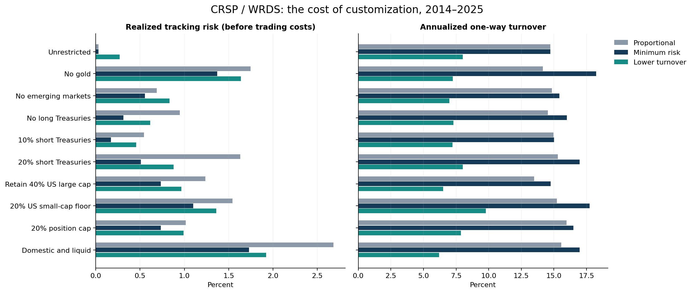

# Personalized Model Portfolios

## The cost of customization — WRDS / CRSP edition

**How much tracking risk should a portfolio manager accept to accommodate account
restrictions and avoid unnecessary trading?**

This Jupyter study now uses **CRSP daily total returns retrieved directly from
WRDS** and a funded walk-forward portfolio simulation. It replaces the original
Yahoo/static-allocation version.

### What is real

- **32,192 CRSP security-day observations**, eight ETFs, **2010–2025**.
- Historical security identities resolved to permanent identifiers at the sample
  start; CRSP CIZ return flags and trading-calendar coverage are validated.
- A **2014–2025** evaluation with lagged risk estimates, monthly execution,
  drifting holdings and transaction costs funded from each portfolio.

The policy weights, client restrictions and initial $1 million accounts are
hypothetical experimental inputs. Trading-cost rates are stated assumptions,
not observed fills. WRDS returns do not turn those assumptions into client data.

## Read the research

Open the [executed notebook](01_cost_of_customization.ipynb).



The notebook compares ten account scenarios and three implementation methods:

1. **Bounded proportional allocation** under the client's restrictions.
2. **Minimum estimated tracking risk** relative to the policy model.
3. **Lower turnover within a risk budget**, initially 25 basis points above the
   minimum feasible annualized tracking error.

The full design produces 30 portfolio paths and **4,320 monthly allocation
decisions**, with calendar-year breakdowns, paired block uncertainty intervals
and eight sensitivity specifications. Results describe implementation trade-offs,
not alpha or a recommendation to trade the portfolios.

- [Findings and PM interpretation](docs/RESULTS.md)
- [Research design and execution clock](docs/METHODOLOGY.md)
- [WRDS setup, data contract and licensing](docs/DATA.md)
- [Data-quality receipt](outputs/wrds/data_quality.json)
- [Run configuration and verification receipt](outputs/wrds/run_summary.json)
- [Aggregate scenario results](outputs/wrds/scenario_summary.csv)
- [Sensitivity results](outputs/wrds/sensitivity_summary.csv)

## Reproduce it

Python 3.10–3.12; a licensed WRDS/CRSP account is required for the data extraction.

```bash
git clone https://github.com/JoshGutierrez56/personalized-model-portfolios.git
cd personalized-model-portfolios
python -m venv .venv
```

Activate `.venv` using `.venv\Scripts\activate` on Windows or
`source .venv/bin/activate` on macOS/Linux, then:

```bash
python -m pip install -r requirements.txt
python wrds_data.py --download
python run_research.py
python -m jupyterlab
```

Configure your existing local PostgreSQL password file as explained in
[DATA.md](docs/DATA.md); no credentials are stored in the project. WRDS may request
Duo verification. The download uses read-only bounded queries. Subsequent runs
use a local, hash-verified extract.

Open `01_cost_of_customization.ipynb` and run all cells. Verified, complete cached
research outputs are reused unless `RECOMPUTE=True`; changed code or data triggers
a rerun. There is **no Yahoo or simulated-performance fallback**.

## Verification

```bash
python -m unittest discover -s tests -v
python audit_research.py
python check_notebook.py
```

Tests cover chronology, future-return isolation, identical restriction sets,
solver feasibility and risk budgets, fixed-weight exclusions, missing data,
ambiguous identities, self-financing costs, and actual holdings drift. Artificial
fixtures appear only in tests and are never used as the notebook's market evidence.

## Important interpretation

Turnover savings are not automatically economically compelling. With liquid ETFs
and low per-dollar trading costs, avoiding trades can save little money while
accepting materially more tracking risk. The notebook calculates both effects
and reports the trade-off even when it weakens the case for lower-turnover
optimization.

The benchmark is a frictionless policy portfolio with the same monthly timing.
Caps/floors are enforced at execution closes; intervening drift is reported.
SHY is a short Treasury fund, not cash. Weight floors are not share-level no-sell
instructions. Total-return sleeves assume fractional holdings and frictionless
reinvestment of distributions, without tax-lot or market-impact modeling.

Historical identity mapping does not remove fixed-universe selection bias, and
lagged returns do not eliminate revisions in the current CRSP vintage. This is
historical research on model implementation, not stock-level direct indexing,
a production trading system, or evidence of future returns.

## Repository layout

| File | Purpose |
|---|---|
| `wrds_data.py` | Authenticated retrieval, historical IDs, strict coverage and source hashes |
| `portfolio_engine.py` | Bounded allocations and checked convex optimizers |
| `walkforward.py` | Lagged decisions, drifting sleeves, self-financed execution and metrics |
| `run_research.py` | Complete study, sensitivities, charts and provenance |
| `01_cost_of_customization.ipynb` | Executed research narrative and inspection |
| `tests/` | Economic/data validation fixtures, not market results |
| `outputs/wrds/` | Aggregate current research outputs |
| `data/wrds/` | Local-only licensed input; excluded from Git |
| `outputs/wrds_private/` | Local-only detailed daily paths, holdings and trades |

The original `outputs/market/` files are preserved as superseded historical
artifacts. Their Yahoo/static results are **not** the current WRDS results.

Built with pandas, NumPy, scikit-learn, CVXPY/CLARABEL and PostgreSQL/libpq, with
AI coding assistance. The methods and provenance are available for review.
