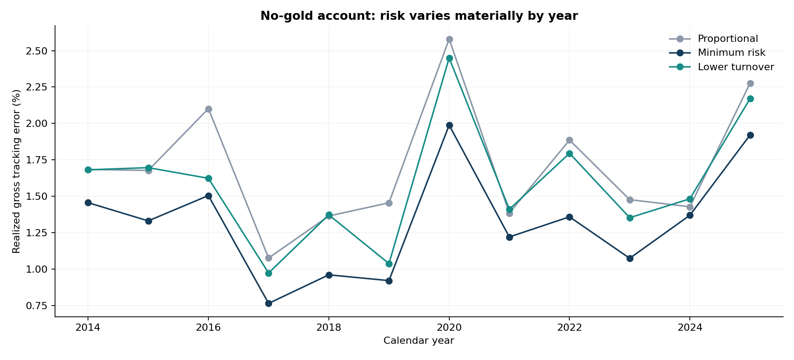

# Results and portfolio-manager interpretation

[Overview](../README.md) | [Executed notebook](../01_cost_of_customization.ipynb) | [Methodology](METHODOLOGY.md) | [Reproduce](REPRODUCING.md)

**Study:** 2014-2025 walk-forward evaluation, using the September 30, 2026 WRDS/CRSP CIZ extract. Real total returns underpin hypothetical account policies and trading-cost assumptions.

## Executive finding

Covariance-aware allocation reduced realized gross tracking error versus bounded proportional allocation in **all nine constrained scenarios**, by **19.75-68.86%** (median **35.50%**). Reducing turnover added tracking risk while delivering small direct cost savings in this liquid ETF universe.

These are implementation results. The experiment does not establish alpha, an expected-return forecast, or tax savings.

## Complete scenario comparison

Annualized gross tracking error, 2014-2025. All methods face the same bounds within each scenario. The unrestricted row is included as a control, not counted among the nine constrained comparisons.

| Account constraint | Proportional TE | Minimum-risk TE | Lower-turnover TE |
| :--- | ---: | ---: | ---: |
| Unrestricted | 0.03% | 0.03% | 0.27% |
| No gold | 1.75% | 1.37% | 1.64% |
| No emerging markets | 0.69% | 0.55% | 0.83% |
| No long Treasuries | 0.95% | 0.31% | 0.61% |
| 10% short Treasuries | 0.55% | 0.17% | 0.46% |
| 20% short Treasuries | 1.63% | 0.51% | 0.88% |
| Retain 40% US large cap | 1.24% | 0.73% | 0.97% |
| 20% US small-cap floor | 1.54% | 1.10% | 1.36% |
| 20% position cap | 1.02% | 0.73% | 0.99% |
| Domestic and liquid | 2.68% | 1.73% | 1.92% |

TE is the standard deviation of daily returns relative to the policy model, annualized by the square root of 252. The initial legacy-to-model transition is retained, so unrestricted implementation has small nonzero TE.

[All metrics for all 30 paths, CSV](../outputs/wrds/scenario_summary.csv) | [Risk-comparison graphic](../outputs/wrds/visual_brief/01_risk_aware_allocation.png)

## No-gold case: price the turnover benefit

| Metric | Minimum tracking risk | Lower turnover |
| :--- | ---: | ---: |
| Annualized gross tracking error | 1.37% | 1.64% |
| Annualized one-way turnover | 18.23% | 7.25% |
| Annualized modeled trading cost | 1.82 bp | 0.72 bp |
| Total simulated trading expenses | $3,009.62 | $1,281.23 |

Turnover falls **60.26%**, but realized TE increases **26.99 bp**. Annualized cost-rate savings of **1.10 bp** scale to roughly **$110 per $1m of constant NAV per year**. Actual simulated dollar expenses vary with account wealth; the annualized rate comparison is not the exact CAGR drag or the annual bill of a fixed-value account.

Costs assume **5 bp per dollar bought or sold**, with both sides charged. The paired 21-day block-bootstrap interval for the TE increment is **20.0-35.6 bp** (95%, 1,000 resamples). It is conditional on this sample, not protection against a new regime.

## Returns are a different objective

| No-gold implementation | Net annualized return | Terminal value of $1m |
| :--- | ---: | ---: |
| Minimum tracking risk | 7.03% | $2.26m |
| Proportional | 7.66% | $2.42m |
| Lower turnover | 7.81% | $2.46m |
| Policy benchmark, including 10% gold | 8.10% | $2.54m |

The policy benchmark is frictionless; account results deduct modeled trading costs. Return differences reflect exposure paths, not demonstrated alpha. A smaller active-return variance does not guarantee a smaller cumulative wealth gap.

[Wealth and rolling-risk graphic](../outputs/wrds/visual_brief/03_wealth_and_risk.png)

## Tracking risk changes through time

Full-period risk averages conceal different market regimes. The calendar-year breakdown below shows the no-gold account's tracking risk under each implementation.

[Calendar-year results, CSV](../outputs/wrds/annual_summary.csv)

## Sensitivity and diminishing savings

All eight sensitivity specifications rerun the full simulation for three illustrative account constraints. The baseline remains fixed; the evaluation period is not used to choose a winning specification.

- **Risk histories:** 252 and 504 observations, versus the 756-day baseline.
- **Covariance:** unshrunk sample covariance versus Ledoit-Wolf.
- **Risk allowance:** 0 and 50 bp, versus 25 bp.
- **Trading costs:** 1, 10, and 25 bp per traded dollar, versus 5 bp.

In the no-gold case, raising the TE allowance from 25 to 50 bp raises the realized TE increment versus minimum risk from **27.0 to 54.0 bp**, while modeled annual cost savings rise from about **$110 to $115 per $1m**. At a 25 bp trading-cost assumption, savings are about **$549/year per $1m**—a different assumption, not observed execution costs.

[Full sensitivity results, CSV](../outputs/wrds/sensitivity_summary.csv) | [Sensitivity graphic](../outputs/wrds/visual_brief/04_sensitivity_economics.png)

## PM judgment

Use risk-aware allocation to measure the exposure cost of customization. Do not accept additional tracking risk solely because a turnover percentage looks dramatically better: express the benefit in account-level dollars.

Tax lots, illiquid instruments, and operational limits could change that decision, but those benefits are not measured here. An optimizer makes the trade-off explicit; it does not determine the client's preferences.

## Evidence and boundaries

- [Data-quality receipt](../outputs/wrds/data_quality.json)
- [Run settings and source hashes](../outputs/wrds/run_summary.json)
- [Independent accounting and chronology audit](../outputs/wrds/AUDIT.json)
- [Visual-brief provenance](../outputs/wrds/visual_brief/visual_brief_receipt.json)
- [Methodology and limitations](METHODOLOGY.md#scope)

No tax-lot accounting, calibrated price impact, point-in-time stock-selection universe, live client records, or production order management. Historical identity mapping and lagged decisions do not remove the limitations of a retrospectively selected fixed universe and a current-vintage database.
